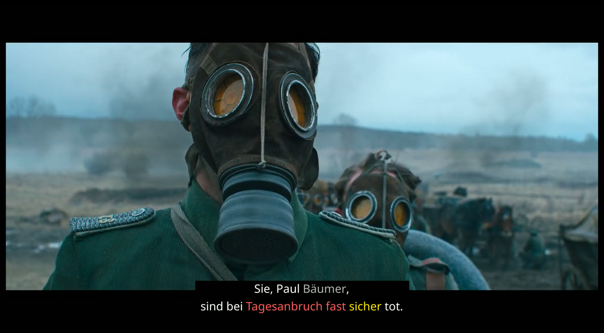

# danki

Mine German vocabulary and sentences from videos in **mpv** straight into **Anki**
(the name: **D**eutsch + **Anki**; formerly german-anki).

> **Note:** This project, code and documentation alike, was generated with AI.



- `Ctrl+W` in mpv: pick a word from the subtitle. A card is made with a definition,
  examples, a conjugation table, a screenshot, the line's audio and a pronunciation.
- `Ctrl+E` in mpv: save a whole sentence (with your English translation) as two cards.
- Subtitles are coloured by what's already in your deck: white = known, red = new,
  yellow/blue = in Anki but missing media, gray = not a dictionary word. `Alt+C` toggles.
- No subtitles? `danki subs VIDEO` writes them with [whisper.cpp](https://github.com/ggml-org/whisper.cpp),
  which the installer builds for you.

## Install

New to this? Follow the [beginner's guide](docs/GUIDE.md) step by step.

```sh
git clone https://github.com/WaleedKhamees/danki && cd danki
./install.sh
```

Start Anki with the **AnkiConnect** add-on (code `2055492159`) first, and the installer offers to
create the decks and the note type. Already have them on AnkiWeb? Answer `n` and sync instead.

Then:

1. Put your `OPENROUTER_API_KEY` in `~/.config/danki/.env`.
2. If Anki wasn't running during the install, start it and run `danki setup-anki`.
3. Run `danki doctor` and fix anything that isn't ✓.

Update with `git pull && ./install.sh`. Coming from german-anki? Running the new `./install.sh`
moves your config, data and settings over to the new names.

`install.sh` also builds whisper.cpp (in `~/.local/share/danki/whisper.cpp`, a few minutes; needs git, cmake and a C++
compiler) and downloads its model (~250 MB) and the VAD model. `--skip-whisper` leaves that out. It
uses a `whisper-cli` already on your PATH instead of building one.

 Remove with `./uninstall.sh [--purge]`.

## Commands

| Command | What it does |
|---|---|
| `danki` | make cards for the words in the clipboard |
| `danki regen` | regenerate the cards you tagged `regen` in Anki (see below) |
| `danki sentences` | import sentence pairs from `sentence-mining.md` |
| `danki subs [FILE…]` | write `FILE.srt` with whisper.cpp; without files, pick them with fzf |
| `danki sync` | refresh the word list used for subtitle colours |
| `danki setup-anki` | create the missing decks and note type in Anki |
| `danki doctor` | check the installation |
| `danki paths` | show where config and data are stored |

Captures from mpv go through a background worker (`danki serve`, started on demand) that
keeps the browser for conjugation tables open, so each capture skips 1–2 s of start-up. It stops
after 15 idle minutes and restarts by itself after config or code changes; its log is
`~/.cache/danki/worker.log`.

Run `danki --help` for the rest. `install.sh` also sets up bash completion for
subcommands, options and, after `regen`, the words in your deck.

### Regenerating cards

Tag bad cards `regen` in Anki, then run `danki regen`. In the browser, select the
cards and press `Ctrl+Shift+A`. While reviewing, press `E` to edit the note, then
`Ctrl+Shift+T` to jump to its tags. For a single key during review, flag the card instead
(`Ctrl+1`, red) and run `danki regen --query 'flag:1'`. Each note is updated in place, so its review history is kept. The
`Screenshot` and `SourceAudio` from the video are never touched. When a note is done, its
tag is removed.

```sh
danki regen                          # every note tagged `regen`
danki regen Leiter Haus              # these words instead
danki regen --query 'flag:1'         # any Anki search within the deck
danki regen Leiter --hint 'ladder'   # tell the LLM which meaning you want
danki regen --only examples          # redo only some parts: definition,examples,conjugation,pronunciation
danki regen --dry-run                # just list what would be regenerated
danki regen Haus --only examples --min-words 6 --max-words 12   # shorter examples
```

Close the note in Anki's browser first. AnkiConnect doesn't update a note that is open in the
editor. Old conjugation images are left unused; Tools → Check Media removes them.

### Making subtitles

```sh
danki subs film.mkv                 # writes film.srt next to it
danki subs *.mp4 --lang en          # several files, English speech
danki subs                          # pick files in this folder (Tab: several, Ctrl+A: all)
danki subs film.mkv --overwrite     # replace an existing film.srt
```

Speech-to-text runs on your CPU, so a long video takes a while. Whisper drifts out of sync during music, so the audio first goes through a voice
detector (Silero VAD); quiet lines it dropped are then transcribed again on their own. Settings:
`WHISPER_*` in `.env` (a bigger model, the language, the thread count).

## Configuration

All settings (deck names, note type, hotkeys, colours) live in
`~/.config/danki/.env`. See `.env.example` for every option.

Example sentences are 10–25 words long by default (`EXAMPLE_MIN_WORDS`, `EXAMPLE_MAX_WORDS`).
`danki words`, `add-row` and `regen` take `--min-words N` / `--max-words N` to change
that for one run.

The note type (default `Basic with example`) needs the fields
`Word, Definition, Conjugation, Screenshot, SourceAudio, Examples, Pronunciation`.

## Tests

```sh
~/.local/share/danki/venv/bin/pip install -e '.[test]'
~/.local/share/danki/venv/bin/pytest
```
