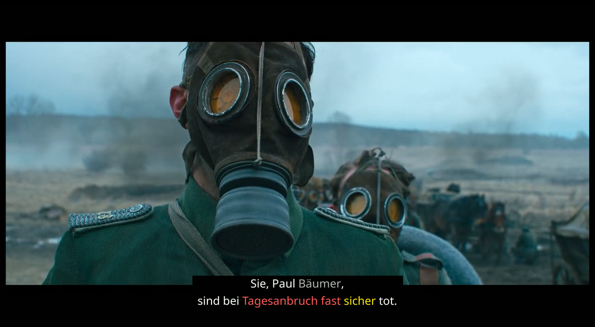

# Beginner's guide

This guide assumes you have never used a terminal, mpv or AnkiConnect. Setup takes about
20 minutes, once. After that, making a flashcard takes a few key presses.

**What you get:** you watch a German video, press a key when you hear a new word, and a
finished flashcard appears in Anki. It has a definition, example sentences, a
conjugation/declension table, a pronunciation, a picture from the scene and the spoken line.



## Before you start

You need:

- **A Linux computer**: Ubuntu 22.04+, Debian 12+, Fedora or Arch (or a relative, such as
  Mint). Windows and macOS are not supported at the moment.
- **About 1.5 GB of free disk space** and an internet connection.
- **An [OpenRouter](https://openrouter.ai) account with some credit.** It pays for the AI that
  writes the definitions. With the default model, $1 is enough for thousands of cards.
- **German videos with German text subtitles** (see [Subtitles](#subtitles)).

To make a card, the word is sent to OpenRouter, Tatoeba, DWDS and verbformen. Your videos,
screenshots and audio clips go into your Anki collection, and if you sync with AnkiWeb, they
are uploaded there too.

### Using the terminal

Open the app called **Terminal**. Where this guide shows a grey box with a command, copy it,
paste it with `Ctrl+Shift+V` and press Enter. If it asks for a password, type your computer's
password. Nothing shows while you type; that is normal.

## Setup

### 1. Set up Anki

**Install Anki** from [apps.ankiweb.net](https://apps.ankiweb.net). Prefer this over your
distribution's app store: those versions can be old, or walled off from your files.

**Install AnkiConnect**, which lets other programs add cards:

1. In Anki, open **Tools → Add-ons → Get Add-ons…**
2. Enter `2055492159` and click OK.
3. Restart Anki.

**Already use Anki with AnkiWeb?** Sync now, before you continue.

**Leave Anki open** for the remaining steps.

### 2. Install german-anki

First get `git`, the download tool. Run the line for your system:

```sh
sudo apt install git      # Ubuntu, Debian, Mint
sudo dnf install git      # Fedora
sudo pacman -S git        # Arch
```

Then download and install german-anki:

```sh
cd ~
git clone https://github.com/WaleedKhamees/german-anki
cd german-anki
./install.sh
```

It lists any missing programs and asks before installing them: press Enter to agree. It then
downloads a dictionary and a small browser, which can take several minutes.

Near the end it shows which decks and card layout are missing in Anki and asks whether to create
them. Press Enter to agree. (If Anki wasn't open, the installer says so. Open it and run
`german-anki setup-anki`.)

It ends with a checklist. **An ✗ next to `OPENROUTER_API_KEY` is expected**; you fix it next.

> Don't move or delete the `german-anki` folder afterwards. The program runs from there.

### 3. Add your OpenRouter key

1. Create a key at [openrouter.ai/keys](https://openrouter.ai/keys) and copy it. Treat it like a
   password.
2. Open the settings file:
   ```sh
   nano ~/.config/german-anki/.env
   ```
3. Use the arrow keys to go to the line `OPENROUTER_API_KEY=` and paste the key right after the
   `=`, with `Ctrl+Shift+V`.
4. Save with `Ctrl+O`, then Enter. Leave with `Ctrl+X`.

### 4. Check that everything works

Log out of your computer and back in, start Anki, and run:

```sh
german-anki doctor
```

You want a ✓ on every line. Below each ✗ there is an arrow (→) that says how to fix it. When it
says **everything looks good**, setup is done.

## Make your first card

1. **Open Anki** and leave it running.
2. **Open a German video in mpv**: right-click the file → *Open with* → *mpv*. The first time,
   the subtitles turn mostly red. That's right: your deck is still empty.
3. When you see a word you don't know, press **`Ctrl+W`**. The video pauses and a panel opens.
4. **Pick:** choose the word with `↑` `↓`, or type part of it. Press Enter.
5. **Edit:** change it to its dictionary form (see below). Press Enter.
6. **Meaning:** optional; just press Enter. This is a note in your own word log and does **not**
   appear on the card.
7. The video continues. A few seconds later you see **Anki ✓** in the corner.

Look in your German deck: the card is there.

### Type the dictionary form

The program looks up exactly what you type in step 5, so this decides how good the card is.

| In the subtitle | Type | Why |
|---|---|---|
| ging | `gehen` | verbs: the infinitive |
| Häusern | `Haus` | nouns: singular, capital letter, **no** der/die/das (it's added for you) |
| schönen | `schön` | adjectives: no ending |
| schließe … zu | `zuschließen` | split verbs: join them |

For a split verb, press `Tab` on each part to mark both, press Enter, then fix the word.

### Save a whole sentence

Press **`Ctrl+E`** instead. Press Enter to take the whole line, correct it if needed, then type
the English translation yourself (it's required). You get two cards: German → English and
English → German.

## What the colours mean

| Colour | Meaning | What to do |
|---|---|---|
| White | already in your deck, or a very common word (*der, und, ich*) | nothing |
| **Red** | a German word not in your deck | `Ctrl+W` if you want to learn it |
| **Yellow** | in your deck, but without a picture | `Ctrl+W` adds picture and sound |
| **Blue** | in your deck with a picture, but without sound | `Ctrl+W` renews both |
| Gray | not in the dictionary: a name, a typo | usually ignore it |

White means "in the deck", not "you know it by heart". The colours understand word forms: a
card for *gehen* also covers *ging* and *gegangen*.

## Keys in mpv

| Key | What it does |
|---|---|
| `Ctrl+W` | capture a word |
| `Ctrl+E` | capture a sentence |
| `Alt+C` | colours on/off |
| `Esc` | in the panel: one step back, or close |
| `Space` | pause/play |
| `←` `→` | jump back/forward |
| `j` | next subtitle track |
| `v` | hide/show subtitles |
| `z` `Z` | shift the subtitles if they're out of sync |

## Subtitles

- The subtitles must be **German** and must be **text** (for example `.srt` files). Subtitles that
  are pictures, as on many DVDs and Blu-rays, or that are burned into the video don't work.
- Have a separate subtitle file? Give it the same name as the video (`film.mkv` and `film.srt`)
  in the same folder, or drag it onto the mpv window.
- Wrong language? Press `j` until German appears.
- Watching a web link directly in mpv can work, but there is often no audio clip. Local files are
  more reliable.

## Fix a bad card

If a definition or example is wrong, have it made again. Your review history, picture and scene
audio are kept. **Close the card in Anki's browser/editor first**, then:

```sh
german-anki regen Leiter                         # redo this card
german-anki regen Leiter --hint 'ladder'         # ...and say which meaning you want
german-anki regen Leiter --only examples         # redo only the examples
```

To collect bad cards while reviewing, flag them red (`Ctrl+1`) and redo them all later:

```sh
german-anki regen --query 'flag:1'
```

These stay flagged afterwards, so remove the flags in Anki before the next round.

## Make cards without a video

Copy one or more words (one per line) and run `german-anki`. It makes a card for **every line
in your clipboard straight away**, so check what you copied first.

## When something goes wrong

**Always start with `german-anki doctor`**, with Anki open. Most problems show up there.

| Problem | Solution |
|---|---|
| `german-anki: command not found` | Log out and in again. Still there? Run `~/.local/bin/german-anki doctor`, and look for a "not in your PATH" warning from `./install.sh`. |
| AnkiConnect is not reachable | Start Anki. Check that the add-on is installed, then restart Anki. |
| "deck" or "note type" ✗ | Open Anki and run `german-anki setup-anki`. |
| `OPENROUTER_API_KEY` ✗ | Repeat [step 3](#3-add-your-openrouter-key). |
| Error 401 or 402 | 401: the key is wrong. 402: your OpenRouter credit has run out. |
| "No subtitle on screen" | Press `Ctrl+W` while a subtitle is visible. |
| Nothing is coloured, keys do nothing | Is it really mpv? mpv from Flatpak or Snap can't see the scripts; install it through `./install.sh` or your package manager. |
| Almost everything is gray | The dictionary is missing: `german-anki setup-dict`. |
| A card has no table or pronunciation | Not every word has one. If it was a connection problem, try `german-anki regen WORD`. |

**You saw "Anki ✗ … row kept in the to-do file".** Nothing is lost. Often Anki was simply closed:

1. Open Anki.
2. Open `~/.local/share/german-anki/To-do-german-words.md`.
3. Copy **only the rows with your words, not the first two lines** (the table heading would become
   cards as well).
4. Run `german-anki`.
5. When it's done, delete those rows from the file.

For sentences, run `german-anki sentences --skip-duplicates`, then delete the imported rows from
`sentence-mining.md` in the same folder.

## Update or remove

```sh
cd ~/german-anki
git pull && ./install.sh      # update; keeps your settings and data
./uninstall.sh                # remove; keeps your settings and data
./uninstall.sh --purge        # remove everything, including captured pictures and sound
```

None of these delete your cards in Anki.

Want different keys, colours or deck names? They're all in `~/.config/german-anki/.env`, each with
an explanation. Restart mpv after changing it.
